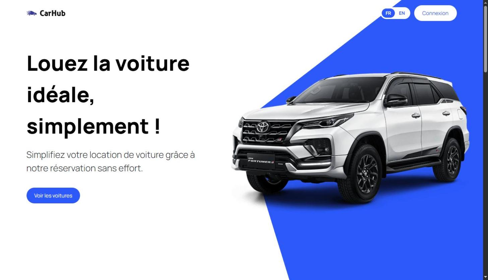
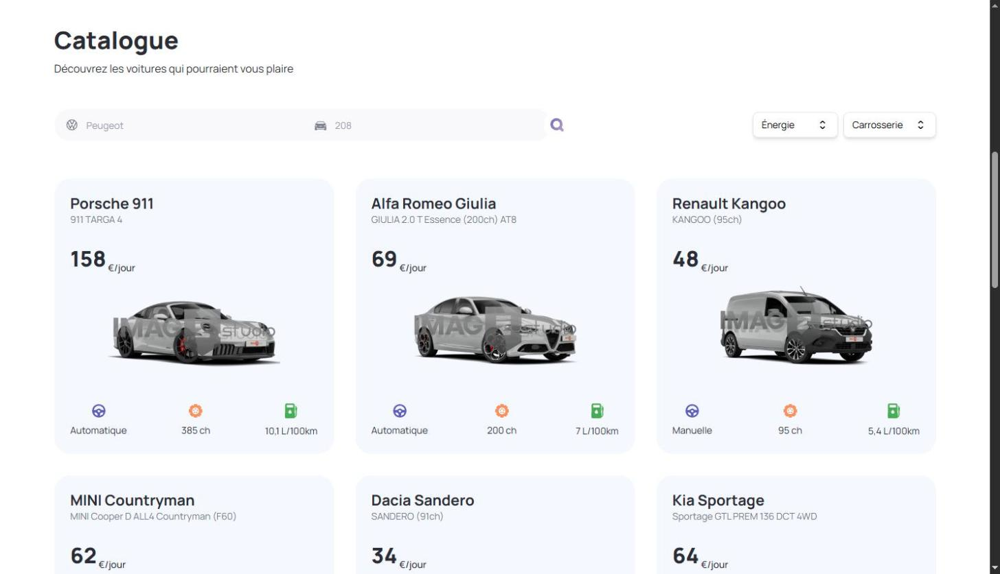
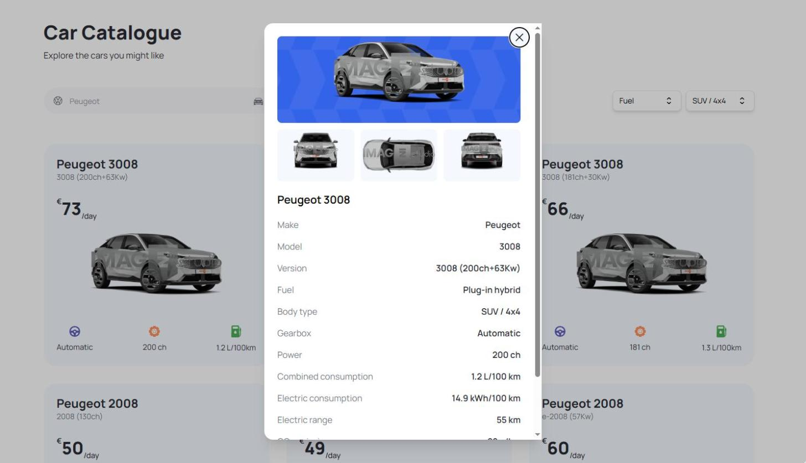

# CarHub

**Find the right car. Rent it in a click.**

CarHub is a car rental catalogue built for the French market. It lists every new car currently sold in France, with official consumption, CO₂ and list-price data. Each car gets a daily rental price, a detail sheet and a front, top and rear view. The site is in French by default, with English one click away.



## Features

- **French car catalogue**: 659 versions from 37 brands (Renault, Peugeot, Citroën, Dacia, DS, Alpine and more), taken from the official ADEME Car Labelling dataset
- **Search and filters**: search by brand and model, and filter by fuel type (petrol, diesel, hybrid, plug-in hybrid, electric, E85/LPG) and body type
- **Metric units**: L/100 km, kWh/100 km, electric range in km, CO₂ in g/km, power in ch and prices in euros, formatted for each language
- **Daily rental price**: worked out from each car's real list price
- **Car details**: a full spec sheet with front, top and rear renders that load in the background while you hover a card
- **French and English**: switch from the navbar; the choice is remembered in a cookie and the page is rendered on the server in that language
- **Responsive**: works on phones, tablets and desktops

| Catalogue | Car details |
| --- | --- |
|  |  |

## Tech stack

Next.js 14 (App Router) · React 18 · TypeScript · Tailwind CSS · Headless UI · ADEME Car Labelling (open data) · IMAGIN.studio

## Getting started

```bash
npm install
npm run dev
```

Open [http://localhost:3000](http://localhost:3000). No API keys or environment variables are needed: the car data ships with the repo in `data/cars.json`, and the car renders use IMAGIN.studio's public demo key (watermarked).

### Updating the car data

ADEME updates its dataset a few times a year. To rebuild `data/cars.json` from the latest version:

```bash
node scripts/build-cars-data.mjs
```

## Scripts

| Command | Description |
| --- | --- |
| `npm run dev` | Start the dev server |
| `npm run build` | Production build |
| `npm start` | Serve the production build |
| `node scripts/build-cars-data.mjs` | Rebuild the car dataset from ADEME |
